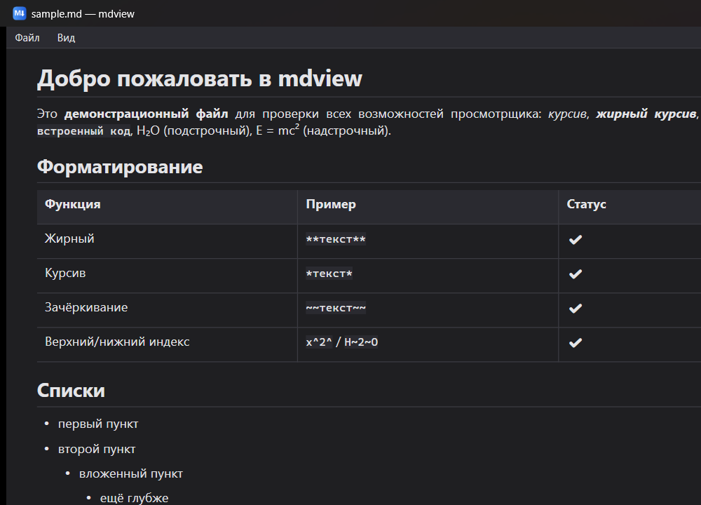

# mdview

[](https://github.com/dimzon/mdview/actions/workflows/ci.yml)
[](https://github.com/dimzon/mdview/actions/workflows/release.yml)
[](LICENSE)

Лёгкий просмотрщик Markdown-файлов на .NET 8 + WPF. Markdown парсится библиотекой
[Markdig](https://github.com/xoofx/markdig) (единственная зависимость) и конвертируется
в стандартный `FlowDocument`, который отображается штатным `FlowDocumentScrollViewer` —
без WebView и HTML.



## Скачать

Последний релиз — на странице [Releases](https://github.com/dimzon/mdview/releases):

- `mdview-vX.Y.Z-win-x64.zip` (~0,7 МБ) — нужен установленный [.NET Desktop Runtime 8](https://dotnet.microsoft.com/download/dotnet/8.0)
- `mdview-vX.Y.Z-win-x64-selfcontained.zip` (~65 МБ) — автономный, рантайм не требуется

## Возможности

- Заголовки h1–h6, списки (в т.ч. вложенные и task-списки ☑/☐), таблицы с выравниванием,
  блоки кода (выделяются и копируются), цитаты, горизонтальные линии
- Форматирование: жирный, курсив, зачёркивание, верхний/нижний индекс, встроенный код
- Ссылки: внешние открываются в браузере, **относительные `.md`-файлы — прямо в просмотрщике**
- Картинки: локальные (относительно папки .md) и по http/https
- Оглавление по заголовкам с переходом к разделу
- Светлая/тёмная тема: по умолчанию берётся из настроек Windows, выбор в меню
  запоминается и имеет приоритет; меню, скроллбары и заголовок окна тоже перекрашиваются
- Печать (Ctrl+P) и экспорт в XPS (Ctrl+S) штатными средствами WPF
- Локализация: русский и English, по умолчанию — язык системы; переключение на лету
- Зум: Ctrl+колесо, Ctrl +/−, Ctrl+0
- Открытие: Ctrl+O, перетаскивание файла в окно, аргумент командной строки

## Сборка и запуск

```bash
dotnet build -c Release
dotnet run -c Release            # или запустить bin/Release/net8.0-windows/mdview.exe
mdview.exe sample.md             # открыть файл из командной строки
```

## Версионирование

Версия сборки вычисляется автоматически из git-тегов с помощью
[MinVer](https://github.com/adamralph/minver): тег `v1.2.3` → версия сборки `1.2.3`
(она видна в «Справка → О программе»). Пуш тега `v*` запускает CI, который собирает
дистрибутивы и публикует их в GitHub Release с автогенерируемыми примечаниями.

## Горячие клавиши

| Клавиши | Действие |
|---|---|
| Ctrl+O | Открыть файл |
| F5 | Перечитать текущий файл |
| Ctrl+T | Показать/скрыть оглавление |
| Ctrl+P | Печать |
| Ctrl+S | Сохранить как XPS |
| Ctrl+колесо / Ctrl +/− | Масштаб |
| Ctrl+0 | Сбросить масштаб |

## Лицензия

[BSD-2-Clause](LICENSE).
